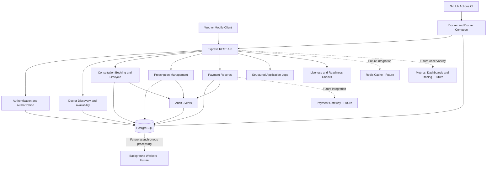
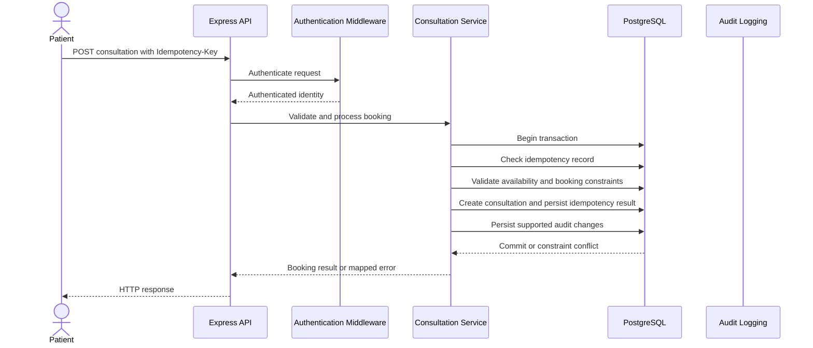
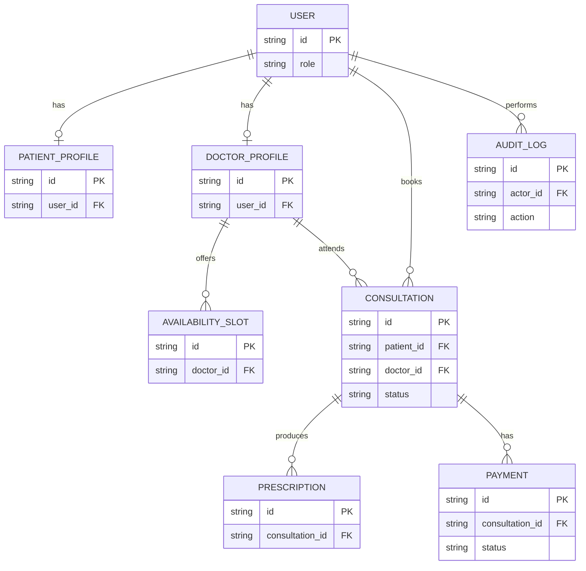

# Amrutam Telemedicine Backend — Architecture and Design

## 1. Overview

The Amrutam Telemedicine Backend provides REST APIs for authentication, doctor discovery, availability management, consultation booking, consultation lifecycle management, prescriptions, payment records, and audit logging.

The application uses **Node.js, TypeScript, Express, PostgreSQL, and Prisma ORM**. It follows a **modular monolith architecture**: business capabilities are separated into modules while the API is deployed as a single application. PostgreSQL is the source of truth for persistent business data and enforces important integrity and concurrency constraints.

The design prioritizes secure access, transactional consistency, reliable booking, idempotent writes, maintainability, and a path toward future horizontal scaling.

### Architecture objectives

The system is designed with the following assignment targets:

- **Scale:** Support growth toward 100,000 consultations per day.
- **Read performance:** Target p95 read latency below 200 ms.
- **Write performance:** Target p95 write latency below 500 ms.
- **Availability:** Target 99.95% service availability.
- **Security:** Authentication, role-based authorization, ownership checks, input validation, and auditability.
- **Reliability:** Database transactions, idempotency, concurrency constraints, automated tests, and health checks.
- **Operability:** Structured logging, automated CI, containerized deployment, and documented recovery procedures.

These are architectural objectives, not measured production guarantees. Meeting them requires representative load testing, production monitoring, capacity planning, and operational validation.

## 2. High-Level Architecture

### Architecture style

The modular monolith is appropriate for the current assignment because it keeps deployment and development manageable while maintaining separation between business capabilities. Transactions can cover related database changes without requiring distributed transactions across multiple services.

Business modules should communicate through clear service interfaces rather than duplicating business rules. If future scale or independent deployment requirements justify a change, selected modules can be extracted into separate services.

### Component responsibilities

| Component        | Responsibility                                                                                 |
| ---------------- | ---------------------------------------------------------------------------------------------- |
| REST API         | Exposes versioned HTTP endpoints and coordinates requests.                                     |
| Authentication   | Handles registration, login, token verification, and authenticated-user access.                |
| Authorization    | Enforces role-aware access and resource ownership checks in protected workflows.               |
| Doctor discovery | Supports doctor profile retrieval, search/filtering, and availability operations.              |
| Consultations    | Handles booking, idempotency, consultation state transitions, and access control.              |
| Prescriptions    | Supports prescription creation for eligible consultations and protected retrieval.             |
| Payments         | Creates and retrieves pending payment records. External payment processing is not implemented. |
| Audit logging    | Records important business actions and associated metadata.                                    |
| PostgreSQL       | Persists business data and enforces relational integrity and concurrency constraints.          |
| Docker Compose   | Defines the local containerized API and database environment.                                  |
| GitHub Actions   | Runs automated validation and build checks.                                                    |

### Current implementation boundary

The implemented application includes the REST API, PostgreSQL persistence through Prisma, authentication and role-aware authorization, core consultation and related workflows, idempotency and database-level concurrency controls, structured logging, audit events, health endpoints, Docker configuration, and automated CI checks.

Redis, a background job queue, payment-gateway processing, production metrics exporters, dashboards, alerting infrastructure, and distributed tracing are not currently implemented. They are future extensions rather than dependencies of the current core workflows.

## 3. Core Workflows and Data Flow

### Authentication and authorization

1. A client sends registration or login details to the API.
2. The API validates incoming data and executes the relevant authentication logic.
3. After successful authentication, the client receives the supported authentication token.
4. Protected requests pass through authentication middleware.
5. Authorization and ownership checks determine whether the authenticated user may access or modify the requested resource.
6. Business changes are persisted through the application’s data-access layer.

Authentication establishes the identity associated with a request. Authorization determines whether that identity has permission to perform the operation. Both checks are necessary for protected resources.

### Doctor discovery and availability

1. A client requests doctor profiles, search results, or availability information.
2. The API validates supported query parameters.
3. The application retrieves the relevant records from PostgreSQL.
4. The API returns the matching information.

Availability shown to a client is informational until a booking is successfully committed. The booking workflow must revalidate relevant constraints against the database to prevent concurrent requests from creating conflicting records.

### Consultation booking

The booking workflow uses idempotency and database concurrency protection to reduce duplicate bookings and inconsistent results.

The exact internal sequence depends on the implemented service and transaction boundaries. The diagram represents the intended logical flow; it does not imply that every audit event is written through a separate service or that a database transaction is distributed.

### Idempotency and concurrency

Idempotency protects retryable client operations from creating duplicate business results when a client retries a request.

- A repeated request with the same idempotency key and equivalent payload can return the original result.
- Reusing a key with a different payload must be rejected.
- Unique database constraints protect against simultaneous requests using the same key.
- Related database writes should be kept in one transaction where atomicity is required.
- Database constraint violations must be translated into appropriate API responses rather than exposed as raw database errors.

**Application-level checks alone are not sufficient for concurrency safety.** Two requests can pass an application check before either writes to the database. Database constraints and transaction semantics provide the final protection.

The current implementation includes concurrency-focused integration tests for booking retries, overlapping availability, and pending payment creation.

## 4. Data Model and Relationships

The following ER diagram is a conceptual representation of the core domain. It is not a complete listing of the database schema. The actual fields, enum values, optionality, relations, and constraints must be taken from `prisma/schema.prisma`.

The diagram illustrates the domain concepts and possible relationships. Actual table names, identifier types, cardinalities, and fields may differ in the implementation and must not be inferred from this diagram alone.

### Data integrity principles

- Use foreign keys for relationships between persisted records.
- Use appropriate unique constraints to prevent duplicate identifiers and idempotency records.
- Prevent overlapping active availability slots for the same doctor using the implemented database constraint.
- Enforce the rule that at most one pending payment exists per consultation using the implemented partial unique index.
- Use transactions for related state changes that must succeed or fail together.
- Apply authorization and ownership checks before exposing protected patient, doctor, consultation, prescription, or payment data.
- Avoid storing unnecessary personal or sensitive information.

## 5. Transactions, Failure Handling, and Reliability

### Transaction boundaries

A database transaction should be used when a workflow requires multiple related changes to remain consistent. Consultation creation, its idempotency result, and supported audit writes should be transactionally coordinated where required by the implementation.

A transaction must either commit all required changes or roll them back. This protects against partial writes when a later operation fails.

External network calls should not be held open inside long-running database transactions. If an external payment provider is introduced, the integration should use a separate, explicitly designed workflow.

### Retry and backoff strategy

Retries should be limited to failures that are transient and safe to retry.

- Retry eligible transient connection failures, serialization failures, or deadlocks only when the operation can safely be repeated.
- Use bounded exponential backoff with jitter, a maximum retry count, and an overall request deadline.
- Do not blindly retry validation failures, authorization failures, or permanent business conflicts.
- Use idempotency keys for retryable client writes.
- For an uncertain write outcome, inspect the persisted idempotency result before repeating the operation.
- Map known database constraint failures to suitable application-level errors.
- Avoid unbounded retries, which can amplify load during an outage.

A retry policy must be implemented and tested for each operation that requires it; documenting a strategy does not mean every database operation automatically retries.

### Payment consistency and race conditions

The payment workflow currently supports pending payment records; it does not implement external payment-gateway processing or settlement.

Creating a pending payment must be concurrency-safe. A check performed only in application code is insufficient because concurrent requests can both observe that no pending payment exists.

The implemented partial unique index is the final database-level safeguard against multiple pending payments for the same consultation. The application should handle the resulting conflict consistently and return an appropriate response. Integration tests exercise concurrent payment creation.

If a payment gateway is added later, the design should include provider-side idempotency, explicit payment state transitions, webhook signature verification, replay protection, reconciliation of uncertain outcomes, and carefully defined handling of failed or delayed payments.

### Sagas and asynchronous processing

Distributed sagas, an outbox-based event pipeline, and background job processing are not currently implemented.

If future workflows span PostgreSQL and external systems, consider an outbox pattern: persist the business change and an event record in the same transaction, then process the event asynchronously. Consumers should be idempotent, retries should be bounded, and each workflow should define recovery or compensation behavior.

These mechanisms should be introduced only when the corresponding asynchronous workflow exists and its consistency requirements are understood.

## 6. Scalability, Performance, and Partitioning

### Application scaling

The modular monolith can be scaled horizontally by running multiple stateless API instances behind a load balancer. PostgreSQL remains the shared source of truth.

Production deployment should consider:

- Database connection-pool limits and connection lifecycle management.
- Request and database-operation timeouts.
- Graceful shutdown and health-based routing.
- CPU and memory limits.
- Load balancing across healthy API instances.
- Safe configuration and secret management across replicas.

Horizontal scaling does not by itself guarantee the target throughput or latency. Database capacity, query efficiency, connection limits, and contention must also be measured.

### Database performance

To work toward the assignment's p95 latency targets:

- Index frequently filtered and joined columns based on actual query patterns.
- Use bounded pagination for potentially large result sets.
- Select only fields required by an endpoint.
- Inspect PostgreSQL query plans for doctor discovery and consultation queries.
- Monitor slow queries, lock waits, connection-pool saturation, and database resource usage.
- Use representative load tests to identify bottlenecks before adding infrastructure.

No p95 latency target should be described as achieved until it has been measured under a documented workload.

### Caching

Redis caching is not implemented.

A future cache may be useful for frequently requested doctor profiles or search results. Cached information should have an explicit time-to-live, invalidation strategy, and stale-data policy.

**Booking and availability decisions must be validated against PostgreSQL.** A cache must not be treated as the authority for allocating a slot or preventing conflicting bookings.

### Partitioning

Database partitioning is not currently implemented.

If audit records or historical consultations become large enough to justify partitioning, evaluate date-based partitioning against real table sizes, query patterns, retention requirements, and maintenance costs. Use query plans and production measurements to determine whether partitioning improves performance.

Partitioning should not be introduced merely because the system has a projected daily consultation volume.

## 7. Security and Compliance

Security controls should be applied consistently across authentication, business logic, database access, deployment, and operations.

### Current application-level controls

The current backend includes token-based authentication, role-aware authorization and ownership checks in protected workflows, Zod-based input validation, security middleware including Helmet, CORS configuration, authentication rate limiting, bounded JSON request bodies, and audit logging.

Local configuration uses environment variables. Real secrets must not be committed to source control; `.env` should remain excluded from Git, and `.env.example` should contain placeholder values only.

### Production hardening requirements

Before production deployment, verify and implement the controls required for the deployment environment:

- Enforce HTTPS/TLS at the deployment boundary.
- Configure encryption at rest for database storage and backups.
- Use least-privilege database accounts and service identities.
- Store production secrets in a managed secret store and define rotation procedures.
- Verify password hashing, token expiration, token validation, and session-revocation behavior against the implementation.
- Provide MFA for privileged accounts where required by the assignment and operational risk.
- Review authorization for every sensitive resource and state-changing endpoint.
- Minimize sensitive information in application logs and define retention/access policies.
- Scan application dependencies and container images for vulnerabilities.
- Restrict database and administrative interfaces from public access.
- Test backup restoration and document incident-response procedures.

A checklist is not evidence that a control is deployed. Record verification evidence and residual risks in `docs/security.md`.

### Threat-model priorities

| Threat                               | Main mitigation                                                                              |
| ------------------------------------ | -------------------------------------------------------------------------------------------- |
| Unauthorized access                  | Authentication, authorization, ownership checks, and token validation.                       |
| Broken object-level authorization    | Verify access to the specific patient, consultation, prescription, and payment resource.     |
| Invalid or malicious input           | Schema validation, bounded request bodies, and safe database access patterns.                |
| Brute-force login attempts           | Authentication rate limiting and appropriate monitoring.                                     |
| Duplicate or conflicting bookings    | Idempotency, database constraints, and transactions.                                         |
| Duplicate pending payments           | Database-level partial unique index and conflict handling.                                   |
| Credential leakage                   | Environment-based configuration, ignored local secret files, and managed production secrets. |
| Sensitive-data exposure through logs | Log minimization, access controls, and retention policies.                                   |
| Dependency vulnerabilities           | Automated dependency checks, container scanning, and timely remediation.                     |
| Data loss or service disruption      | Backups, restoration drills, health checks, and documented recovery procedures.              |

Telemedicine systems may process sensitive personal and health-related information. Access should be limited to authorized users, and data collection, retention, disclosure, and deletion should follow applicable legal and organizational requirements.

## 8. Observability and Operations

### Implemented observability features

The application includes structured request/application logging, request-context support, audit events, and health endpoints:

- `GET /health/live` indicates whether the API process is alive.
- `GET /health/ready` checks readiness, including database connectivity.

Docker Compose also defines health checks for the API and PostgreSQL. CI validates the application through automated checks.

Liveness and readiness checks are operational signals; they do not replace production monitoring, alerting, or service-level measurements.

### Recommended production observability

Metrics exporters, dashboards, alert rules, and distributed tracing are not currently implemented.

A production deployment should consider collecting:

- Request rate, error rate, and latency percentiles.
- Database query latency, connection-pool usage, and lock contention.
- Booking conflicts and idempotency replay rates.
- CPU, memory, process restarts, and dependency health.
- Authentication failures and rate-limit events.
- Availability indicators and error-budget consumption.

Logs must not expose passwords, access tokens, secret values, or unnecessary patient data. Audit events should capture the minimum information needed to support accountability and investigation.

Alert thresholds should be established using measured baseline behavior and the service's operational objectives.

## 9. Infrastructure, CI, and Deployment

### Containerized environment

The repository includes a Dockerfile and Docker Compose configuration for the API and PostgreSQL. The containerized environment has been built and started successfully, and both services were reported healthy during local verification.

Configuration is supplied through environment variables and the Docker-specific environment configuration. Real credentials must remain outside version control.

The Compose environment supports local reproducibility; it should not be treated as a complete production deployment architecture.

### Continuous integration

The GitHub Actions workflow validates key aspects of the codebase, including type checking, automated tests, PostgreSQL-backed integration tests, and the production build.

The reported verification results are:

- TypeScript type checking: passed.
- Unit tests: passed.
- PostgreSQL integration tests: passed.
- Production build: passed.
- Docker Compose configuration validation: passed.
- Local container health checks: passed.

These results reflect the reported development verification. The latest hosted GitHub Actions result should be confirmed in the repository before submission.

### Deployment safeguards

A production deployment should use separate environment configuration, restricted secret access, database migration controls, health-based rollout, and a tested rollback procedure. Schema changes should be reviewed for compatibility with running application instances and existing data.

Container image scanning, deployment automation, and production monitoring should be added where required by the final deployment environment.

## 10. Availability, Backup, and Disaster Recovery

The assignment's 99.95% availability target corresponds to approximately **21.6 minutes of downtime in a 30-day month**. This is a target, not a guarantee provided by the current local setup.

A production operations plan should define:

- Automated PostgreSQL backups and retention schedules.
- Encrypted backup storage with restricted access.
- Point-in-time recovery where supported.
- Recovery Point Objective (RPO) and Recovery Time Objective (RTO).
- Regular restoration drills and integrity verification.
- Database capacity monitoring and tested recovery procedures.
- Health-based deployment, rollback, and incident escalation.
- Ownership for investigating and resolving service disruptions.

RPO and RTO values must be agreed with the business and validated through recovery tests. Backup creation alone is not sufficient; restoration must be demonstrated.

High availability across multiple failure domains, automated database failover, and disaster-recovery infrastructure require deployment-level configuration and validation beyond the current local Docker Compose environment.

## 11. Testing and Quality Assurance

Testing covers both application behavior and database-dependent concurrency behavior.

### Current verification

The reported results include:

- Unit tests: 10 passed.
- Integration tests: 41 passed across 6 test files.
- Type checking: passed.
- Production build: passed.
- Docker Compose configuration validation: passed.
- Local API liveness and readiness checks: passed.

Integration coverage includes important database-backed workflows and concurrency scenarios such as duplicate booking retries, overlapping availability, and concurrent pending-payment creation.

### Additional validation for production readiness

Before production use, extend or verify coverage for:

- Authentication failures and token expiration.
- Role-based authorization and resource ownership.
- Invalid request payloads and boundary cases.
- Consultation lifecycle transition rules.
- Prescription access and eligibility.
- Payment state handling and idempotency.
- Rate-limit behavior and security middleware.
- Migration behavior and recovery from failed deployments.
- Load tests for the target consultation volume and latency objectives.
- Backup restoration and operational failure scenarios.

Automated test success is necessary but does not, on its own, establish production performance, security, or availability.

## 12. Implementation Status and Future Work

| Capability                                          | Status                                                  |
| --------------------------------------------------- | ------------------------------------------------------- |
| REST API and PostgreSQL persistence                 | Implemented                                             |
| TypeScript and Prisma-based data access             | Implemented                                             |
| Authentication and role-aware access control        | Implemented                                             |
| Doctor discovery and availability workflows         | Implemented                                             |
| Consultation booking and lifecycle workflows        | Implemented                                             |
| Idempotency and database concurrency safeguards     | Implemented                                             |
| Prescription workflow                               | Implemented                                             |
| Pending payment records and concurrency protection  | Implemented                                             |
| Structured logging and audit events                 | Implemented                                             |
| Liveness and readiness endpoints                    | Implemented                                             |
| Dockerfile and Docker Compose                       | Implemented and locally verified                        |
| Automated CI and test suite                         | Implemented; hosted CI result should be confirmed       |
| Redis caching                                       | Future work                                             |
| Background job processing and outbox                | Future work                                             |
| Payment-gateway integration and settlement          | Future work                                             |
| Production metrics, dashboards, alerts, and tracing | Future work                                             |
| Database partitioning                               | Future work, subject to measurement                     |
| Production backup, failover, and disaster recovery  | Requires deployment-level implementation and validation |
| Load testing against performance targets            | Requires measurement and evidence                       |

### Recommended implementation priorities

1. Complete and verify all required core API workflows and their authorization rules.
2. Maintain database-level idempotency and concurrency protection, including the pending-payment uniqueness rule.
3. Keep automated tests and CI passing as the codebase evolves.
4. Verify security hardening and document residual risks in `docs/security.md`.
5. Measure latency and throughput under representative workloads before claiming the performance targets are met.
6. Add production observability, backup/restore validation, and deployment safeguards.
7. Introduce caching, asynchronous processing, or partitioning only when justified by measured requirements.

## 13. Conclusion

The current backend establishes a modular, database-backed foundation for telemedicine workflows. Its use of PostgreSQL transactions, idempotency, database constraints, access control, automated testing, structured logging, health checks, containerization, and CI addresses key reliability and maintainability requirements.

The next stage toward production readiness is to validate the assignment's scale and latency objectives, complete deployment-specific security controls, implement operational monitoring and recovery procedures, and add future infrastructure only when supported by measured needs.

**Source of truth:** `prisma/schema.prisma` defines the actual database schema and constraints; the application source defines the implemented behavior; `docs/openapi.yaml` defines the documented API contract; and `docs/security.md` records the security threat model and verification checklist.

**Important:** Architecture diagrams and targets describe the design and intended behavior. They must not be interpreted as evidence that unimplemented infrastructure or unmeasured production guarantees already exist.
