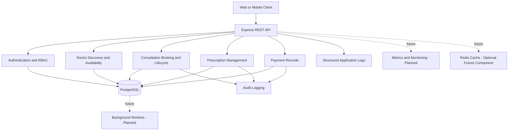
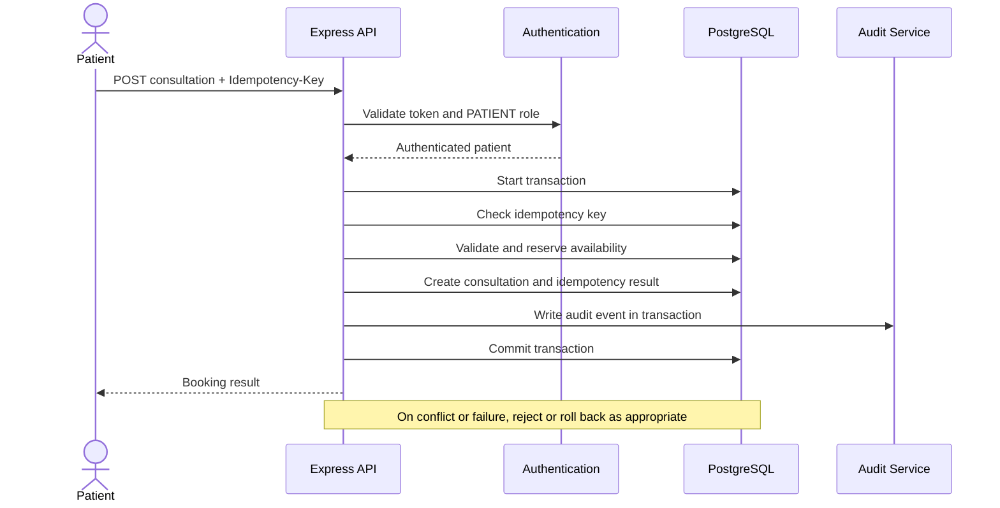
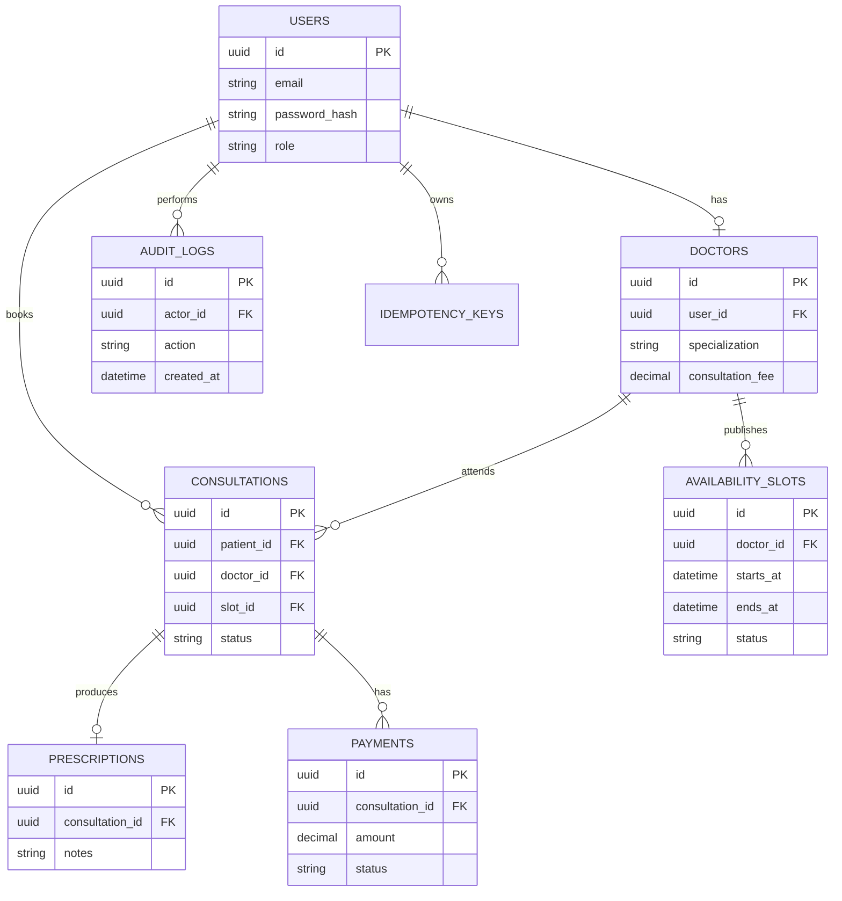

# Amrutam Telemedicine Backend — Architecture and Design

## 1. Overview

The Amrutam Telemedicine Backend provides REST APIs for authentication, doctor discovery, availability management, consultation booking, consultation lifecycle management, prescriptions, payment records, and audit logging.

The current implementation uses Node.js, TypeScript, Express, PostgreSQL, and Prisma ORM. It follows a modular monolith architecture, separating business capabilities into modules while deploying the API as a single application.

The design prioritizes secure resource access, reliable booking, transactional consistency, input validation, and maintainability.

### Architecture goals

- Support growth toward 100,000 daily consultations.
- Target p95 read latency below 200 ms and write latency below 500 ms.
- Design for a 99.95% availability objective.
- Enforce authentication, role-based authorization, and ownership checks.
- Provide structured logs, audit events, health checks, and automated tests.

These are design targets, not measured production guarantees.

## 2. High-Level Architecture

The current implementation includes the REST API, PostgreSQL persistence, authentication, core business modules, structured logging, audit events, and health checks. Redis, background workers, and metrics infrastructure are proposed extensions rather than existing deployed components.

### Component responsibilities

- **Authentication:** Registration, login, token verification, and authenticated user information.
- **Doctor discovery:** Search, filtering, profile retrieval, and availability queries.
- **Consultations:** Booking, idempotency, ownership checks, and lifecycle transitions.
- **Prescriptions:** Creation for eligible completed consultations and access-controlled retrieval.
- **Payments:** Creation and retrieval of pending payment records. Payment gateway processing is not implemented.
- **Audit logging:** Records important business actions with relevant metadata.
- **PostgreSQL:** Persistent storage and enforcement of relational constraints.

## 3. Booking Flow and Concurrency

### Booking sequence

The application uses idempotency keys to make repeated booking requests safe. Repeating the same key and request can replay the original result; reusing a key with a different request is rejected.

Database constraints protect against conflicting availability slots. Transactional writes help ensure that a successful booking and its associated audit record remain consistent.

### Concurrency handling

- Use database transactions for related writes.
- Enforce availability overlap rules at the PostgreSQL level.
- Use unique constraints to prevent duplicate idempotency keys.
- Enforce a single pending payment record per consultation through a database constraint.
- Test concurrent booking attempts and repeated requests.

Application-level checks alone are insufficient for concurrency safety because simultaneous requests can pass the same initial validation. Database constraints provide the final protection.

## 4. Data Model and Relationships

This diagram is a conceptual overview. The Prisma schema is the source of truth for actual table and column definitions; verify names and cardinalities against it before treating this diagram as an exact database specification.

## 5. Transactions, Retries, and Failure Handling

### Transaction management

Operations that change related business records should execute within a database transaction where consistency requires it. Booking and its idempotency record must not be committed independently. Audit events for supported critical operations should be written transactionally with those operations.

Transactions should remain short and should not include slow external network calls.

### Retry and backoff strategy

- Retry transient connection failures and serialization or deadlock conflicts only when safe.
- Use bounded exponential backoff with jitter.
- Set a maximum retry count and a request deadline.
- Do not blindly retry validation errors, authorization failures, or permanent conflicts.
- Use idempotency keys for retryable client writes.
- Treat unknown outcomes carefully: query the persisted idempotency result before repeating a write.

If a future payment gateway is integrated, use explicit payment states, idempotent provider requests, and reconciliation for uncertain outcomes.

### Sagas and asynchronous work

The current backend does not implement a distributed saga or background job queue. If future workflows span the database and external systems, use a saga or an outbox-based design.

For example, a future payment workflow could persist a payment request and outbox event in one transaction, process the event asynchronously, and reconcile provider results. Compensation and retry policies must be defined for each state transition.

## 6. Scalability, Caching, and Partitioning

### Application scaling

The modular monolith can initially scale horizontally by running multiple stateless API instances behind a load balancer. Persistent business state remains in PostgreSQL.

Production deployment should include connection-pool limits, request timeouts, graceful shutdown, resource limits, and health-based routing.

### Database optimization

- Index frequently filtered and joined columns.
- Use pagination with bounded page sizes.
- Select only the fields required by each endpoint.
- Inspect query plans for high-volume doctor search and booking queries.
- Monitor connection usage, lock contention, and slow queries.

### Caching

Redis is optional and is not currently implemented. A future cache could hold frequently requested doctor profiles and search results with short TTLs.

Availability and booking decisions must still be validated against the database. Cache invalidation and stale-data handling are essential.

### Data partitioning

Partitioning is not currently implemented. At the expected growth stage, assess partitioning high-volume audit and historical consultation tables by creation date. Retention policies and query patterns should determine the partition key.

Do not introduce partitioning without measuring table size, query performance, and operational complexity.

## 7. Security and Compliance

The application uses token-based authentication, role-aware authorization, input validation, security middleware, and audit logging.

Production hardening should include:

- TLS in transit and encryption at rest.
- Strong password hashing and secure secret storage.
- MFA for privileged accounts.
- Least-privilege database and service identities.
- Strict CORS configuration and rate limits.
- Sensitive-data minimization in logs.
- Dependency vulnerability scanning and timely patching.
- Secret rotation, access reviews, and audit-log retention policies.
- Tested backup restoration and incident response procedures.

A separate threat model and security checklist should document threats, mitigations, residual risks, and verification evidence.

## 8. Observability and Operations

The application includes structured logging, request-context support, audit events, and liveness/readiness endpoints.

A production observability stack should additionally capture:

- Request count, error rate, and latency percentiles.
- Database latency, connection-pool saturation, and lock waits.
- Booking conflicts and idempotency replay rates.
- Process memory, CPU, restarts, and dependency health.
- Distributed traces across the API and database where supported.

Metrics exporters, tracing infrastructure, dashboards, and alert rules are planned additions and must be implemented and tested before claiming production observability coverage.

## 9. Availability, Backup, and Disaster Recovery

A 99.95% availability target permits approximately 21.6 minutes of downtime in a 30-day month. This target requires measured service-level indicators and an operational plan; it is not guaranteed by the current code alone.

A production deployment should include:

- Automated PostgreSQL backups and point-in-time recovery where supported.
- Encrypted backup storage and restricted access.
- Documented recovery point objective (RPO) and recovery time objective (RTO).
- Periodic restore drills and data-integrity checks.
- Database monitoring, capacity planning, and tested failover.
- Health checks, rolling deployments, and rollback procedures.
- Incident response and operational ownership.

Actual RPO/RTO values must be selected based on business requirements and validated through recovery testing.

## 10. Implementation Status and Future Work

### Implemented

- REST API and modular TypeScript services.
- Authentication and role-based access checks.
- Doctor discovery and availability management.
- Consultation booking and lifecycle management.
- Idempotent booking and database concurrency constraints.
- Prescription management and pending payment records.
- Audit events, structured logging, and health checks.
- Unit and PostgreSQL integration tests.
- README and OpenAPI documentation.

### Planned or requiring further verification

- Administrator analytics endpoints.
- Metrics exporter, dashboards, alerting, and distributed tracing.
- Dockerized deployment and CI/CD workflow.
- Terraform infrastructure configuration.
- Redis caching and background workers.
- Production load testing against latency and throughput targets.
- Formal threat model, security checklist, and disaster recovery drills.

The system should be considered a tested backend implementation with a production-oriented design, not a fully deployed production platform, until the planned infrastructure, security controls, performance tests, and operational procedures are completed.